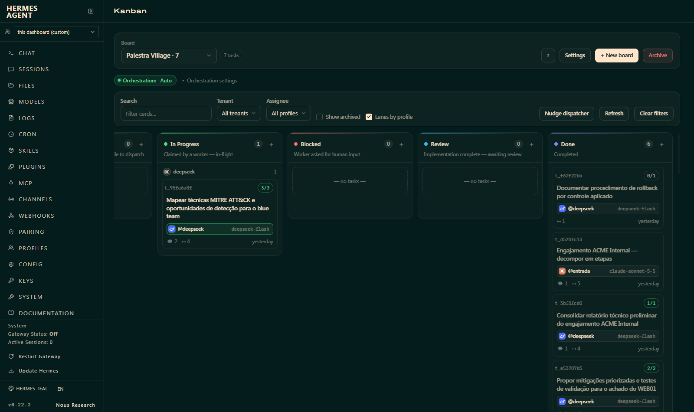

# Hermes Kanban Premium

Plugin de dashboard para o [Hermes Agent](https://github.com/NousResearch/hermes-agent) que melhora o Kanban nativo sem substituir nada. O plugin original continua intacto, então todos os recursos dele seguem funcionando e o plugin sobrevive a `hermes update`.



## O que ele faz

**Visual novo do board e do drawer**
- Tipografia limpa no lugar das fontes do tema dentro do Kanban.
- Botão principal em destaque, ações de risco em vermelho, demais discretas.
- Colunas com fio de status, contador em pílula, checkbox só no hover.
- Cards com sombra leve, barra lateral quando estão rodando ou bloqueados.
- Cores derivadas do tema ativo do dashboard: se trocar o tema, o Kanban acompanha.

**Profile e modelo em cada card**
- Chip com ícone do provedor, `@profile` e nome do modelo.
- O modelo vem da sessão real do worker. Sem execução ainda, usa o override do card e depois o modelo padrão do profile. O tooltip mostra qual fonte foi usada.
- Card rodando: chip verde com o ícone pulsando, atualizado a cada ~8s.

**Painel "Agente" no drawer do card**
- Cabeçalho com modelo, profile, provedor, run, status, tokens (entrada, saída, cache), ferramentas, duração e custo.
- Aba **Chat**: respostas do modelo em markdown (código e tabelas), chamadas de ferramenta compactas que expandem para mostrar o retorno, prompt do worker recolhido, filtro "só respostas" e seletor de run quando houve mais de uma tentativa. Com o card rodando, atualiza a cada 4s trazendo só o que é novo.
- Aba **Arquivos**: arquivos tocados pelo worker, separados entre "fora do workspace" e "workspace do card", com ação (escrito, editado, artefato), contagem, tamanho atual e botão para copiar o caminho.

## Como funciona

| Parte | Arquivo | Papel |
|---|---|---|
| Visual | `dashboard/dist/premium.css` | CSS escopado em `html[data-kp] .hermes-kanban*` |
| Marcação e painel | `dashboard/dist/index.js` | Marca elementos com `data-kp-*`, aplica o chip nos cards e monta o painel no drawer |
| API | `dashboard/plugin_api.py` | Rotas somente leitura em `/api/plugins/kanban-premium/` |

Rotas:
- `GET /cards?ids=t_a,t_b&board=<slug>`: profile, modelo e provedor de cada card.
- `GET /tasks/{id}/activity?board=<slug>&run=<n>&after=<cursor>`: sessão do worker, timeline do chat e arquivos modificados.

Fontes de dados:
- `kanban.db` do board: tasks, runs e metadados do complete.
- `state.db` do profile que executou o run (`profiles/<nome>/state.db`, ou a raiz para `default`): sessão, mensagens e chamadas de ferramenta.
- Sessão do worker: `task_runs.metadata.worker_session_id` (run concluído) ou a primeira linha `Session: <id>` do log do worker (run ativo).
- Arquivos: chamadas `write_file`/`patch`, artefatos declarados no complete, `git status` do worktree e arquivos gerados no workspace do card.

## Instalação

Requer Hermes Agent com o plugin Kanban do dashboard (testado na v0.22.2).

1. Copie a pasta `kanban-premium/` para a pasta de plugins do Hermes:
   - Windows: `%LOCALAPPDATA%\hermes\plugins\`
   - Linux/macOS: `~/.hermes/plugins/`
2. Habilite o plugin no `config.yaml`. Sem isso o dashboard não carrega nem o CSS:
   ```yaml
   plugins:
     enabled:
       - kanban-premium
   ```
3. Reinicie o dashboard (`hermes dashboard`).
4. Abra `/kanban`. Se não aparecer de primeira, recarregue com Ctrl+F5.

Para atualizar: mudança no `plugin_api.py` pede reiniciar o dashboard; CSS e JS só pedem recarregar a página.

Para remover: tire `kanban-premium` do `plugins.enabled` e apague a pasta.

## Segurança

- Tudo é somente leitura. Os bancos são abertos com `mode=ro` e nenhuma rota escreve em task, run ou sessão.
- As rotas ficam atrás da autenticação do próprio dashboard.
- Todo texto que sai passa por `redact_sensitive_text(force=True)` do Hermes.
- Atenção: o painel mostra transcrições dos workers, incluindo saída de terminal e trechos de arquivos lidos. A redação pega padrões conhecidos de segredo, não tudo. Se o seu dashboard for exposto fora da máquina, leve isso em conta.

## Limitações conhecidas

- Arquivos alterados só por comando de terminal (`echo > arquivo`, `sed -i`) não entram na lista. Em worktree git o `git status` cobre; em workspace scratch e caminhos externos, não.
- Arquivo escrito com caminho relativo pode aparecer como "não existe", porque não dá para saber em que pasta o caminho foi resolvido.
- Os ícones dos provedores são marcas simples desenhadas para o plugin, não os logos oficiais.
- O plugin se apoia nas classes CSS do Kanban nativo (`.hermes-kanban-*`). Uma mudança grande no plugin oficial pode exigir ajuste.

## Licença

[MIT](LICENSE)
